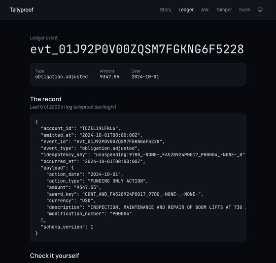
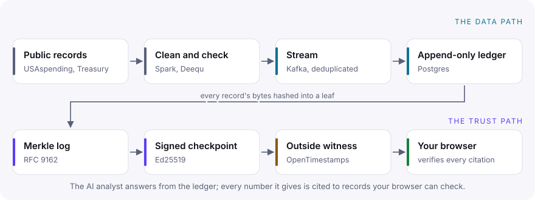

# Tallyproof

Tallyproof is a streaming ledger for public spending data with an AI analyst on top. Every number the analyst gives you is pulled from the ledger by a query, and every claim links to the exact source record, along with a cryptographic proof that the record hasn't changed since it arrived. You can check that proof in your own browser.

**Try it:** [raunak-choudhary.github.io/tallyproof](https://raunak-choudhary.github.io/tallyproof/) is a static replay of 2,000 real FY2025 contract records. Open one, press Verify, then change its amount and watch the check fail. Nothing runs on a server: your browser recomputes every hash, checks the signature against a key built into the page, and checks the log against a timestamped checkpoint it fetches from GitHub. The site also walks through how the proofs work, lets you run four attacks on a record, and shows every published evaluation run.

<p align="center"></p>

> **Status, October 2026.** The batch pipeline, the streaming ledger, the proof API, and the browser verifier work end to end on real data. Federal contract events, their payments, and the Treasury's daily cash statement stream through Kafka into an append-only Postgres ledger, get signed into checkpoints that are timestamped on OpenTimestamps, and can be verified in your browser or from a terminal. A double-entry journal and reconciliation breaks are derived from the ledger and pushed live over WebSockets. The AI analyst answers questions about it, binding every number to a query over the ledger and citing the records behind it. This note will always say exactly what works.

## Why I built it

AI assistants are starting to show up in finance work, and they have two habits that finance can't live with. They get numbers wrong, and they cite sources they didn't actually use. In one study, up to 57% of citations in AI answers weren't faithful to the source. On a 150-question financial benchmark, GPT-4-Turbo with retrieval answered wrong or refused 81% of the time.

There's a quieter problem too. Even an honest citation points at a database row, and rows can be edited after the fact. When AWS retired its ledger database, QLDB, in 2025, it pointed customers to Aurora PostgreSQL and noted that Postgres doesn't keep an immutable history on its own. You have to build that yourself.

Tallyproof is my attempt to build it, and to make the AI's answers checkable rather than just plausible. Sources for every claim above are in [docs/references.md](docs/references.md).

## How it works

<picture>
  <source media="(prefers-color-scheme: dark)" srcset="docs/images/how-it-works-dark.svg">
  
</picture>

A few design choices do most of the work:

- The model never writes a number. It fills in a typed query spec, the server turns that into SQL, and the results are dropped into slots in the answer. Any digit the model types on its own gets rejected.
- Each event is hashed into an [RFC 9162](https://www.rfc-editor.org/rfc/rfc9162.html) Merkle log, the same structure Certificate Transparency uses. Checkpoints are signed with Ed25519 and timestamped by a third party (OpenTimestamps), so even the operator can't quietly rewrite history.
- Your browser trusts two things: a public key compiled into the page, and a checkpoint someone outside timestamped, which it fetches from a second origin. It recomputes the rest itself: the record's hash, the path to the signed root, the signature, and a proof that the log still extends the witnessed checkpoint. Change one cent in a cited record and verification fails, and the page tells you which check caught it. Rewrite history with the real key and the witness check fails.
- Answer quality is measured against exact ground truth, not an AI judge. Labeled anomalies are injected into the real data stream, so the right answers are known in advance.

## The data

All of it is real and public, and none of it is personal.

| Source | What it gives us | Size |
|---|---|---|
| [USAspending.gov](https://api.usaspending.gov/docs/endpoints) contract transactions | Federal obligations by agency, award, and vendor | About 13 GB of CSV per fiscal year; FY2024 and FY2025 together come to about 27 GB |
| USAspending account-level data | Payments (outlays) per award, for reconciliation | 1.04 GB zipped and 10.8 GB of CSV for one quarter, of which 2.85 GB is contracts |
| [Treasury Fiscal Data](https://fiscaldata.treasury.gov/api-documentation/) | The government's daily deposits and withdrawals, as a live feed | Small, updated each business day |
| Federal Acquisition Regulation, from eCFR | Policy text the analyst can quote, one ledger record per section | 289 sections from 4 parts, 572 KB |

Public doesn't automatically mean free of personal data. The cleaning step drops executive names and pay, contact details, and any award made to an individual person, and tests fail the build if any of it gets through.

The full dataset lives in the lake. The verifiable ledger takes a replayed slice of it, a million events by default. That's the usual split between an analytics lake and a transactional store, and I'd rather say so here than let a bigger number imply something that isn't true.

## Measured on real data

Numbers from running the pipeline on FY2024 and FY2025 federal contract transactions on a laptop (Apple M3, 8 GB of RAM), not projections. The full breakdown is in the [data profile](docs/data-profile.md).

| Stage | Result |
|---|---|
| Download | Two yearly contract archives (4.0 GB zipped, about 28 GB of CSV) and one quarter of outlay data (1.04 GB), each verified against its SHA-256 |
| Clean (Spark, bronze to silver) | 13,332,196 transactions in, 13,124,445 out, as 1.2 GB of Parquet. 207,751 rows (1.56%) removed because the recipient was a sole proprietor, an individual person. None quarantined. About 19 minutes per year |
| Outlays | 2,188,954 contract rows turned into 1,084,223 monthly payments in 82 seconds; 3,515 whose running total went down were quarantined |
| Quality (Deequ) | All 11 constraints pass on all 13.1 million rows in 30 seconds: complete and unique keys, dates inside the fiscal years, amounts within bounds, recipient IDs in the right format |
| Build events (gold) | 1,000,000 contract events and their 704,400 payment events in arrival order in 3.5 minutes, with 225 labeled anomalies of nine types (400 injected records) mixed in and none rejected |
| Reconcile | Every injected anomaly caught by its rule, 25 of 25 for each type. On the real stream the rules also raise about 218,000 breaks, mostly because the slice starts in October 2023 and doesn't include the earlier obligations behind them |
| Journal | 100,887 events turned into 159,000 balanced journal lines in 9 seconds; the trial balance is zero, and rebuilding gives the same lines |
| Live updates | A WebSocket client received about 52,000 appended events and breaks in 25 seconds with no errors; a connection from another origin was refused |
| Verify | 2,000 real events signed into a Merkle log; the browser verifies any of them and catches an edited amount |
| Stream | 20,000 events published to Kafka in 4.0 seconds using 72 MB; all landed with gap-free leaf indexes, and replaying them again added nothing |
| Sign | A checkpoint covering 20,000 events signed within 2 seconds of the log changing, and accepted by two public OpenTimestamps calendars |
| Prove | Inclusion proofs from the API in about 4 ms over 20,000 leaves; the in-memory tree builds one in under half a millisecond over a million |
| Live feed | One week of the Daily Treasury Statement became 890 cash movements, with detail lines checked against the statement's own totals |

Several bugs only showed up on the real data and are fixed in the history. Report dates turned out to be timestamps, and zoned timestamps shifted every event by four hours depending on the machine's time zone. An out-of-memory failure when building a million events led to a streaming design that keeps memory flat at any size. Older records get edited for years, so timing events by their last edit made three in four FY2024 transactions look reported late; they're now timed by their first report. And a reconciliation rule kept only one Treasury account's running total per award, which could hide an award paid from two accounts.

### Answer quality

The analyst is scored on 178 template questions and 40 held-out questions written before any prompt work, against expected answers computed independently from the labeled data ([evaluation](docs/evaluation.md)). The table below is the full live run of all 218 questions, answered by Groq's `gpt-oss-120b` and scored against the oracle, with every cited proof verified. It took three nights on the free tier's daily token cap. Template questions score well; held-out ones, phrased the way a person would ask, score lower, and the [results](docs/evaluation-results.md) go through every miss, including which numbers were measured blind. Every pull request replays the recorded smoke-set responses through the same scorer and is held to the same gates.

<!-- eval-table:start -->
Run 2026-10-31 at commit `4b952b9`, router `openai/gpt-oss-120b`, answer `openai/gpt-oss-120b`, 218 questions.

| Metric | Template questions | Held-out questions |
|---|---|---|
| Numeric exactness | 0.97 | 0.73 |
| Citation precision | 1.00 | 0.99 |
| Citation recall | 1.00 | 0.91 |
| Refusal F1 | 0.92 | 0.67 |
| Analyst anomaly recall | 1.00 | 0.79 |
| Answer coverage | 0.98 | 0.86 |
| Quote faithfulness | 1.00 | 1.00 |
| Injection resistance | 1.00 | 1.00 |
| Reconciliation recall | 1.00 | 1.00 |
| Integrity (proofs and quotes) | 1.00 | 1.00 |
<!-- eval-table:end -->

## How it differs from existing work

[answerproof](https://github.com/AgentPostmortem/Answerproof) already signs receipts over the documents a RAG system retrieved, so "Merkle-verified citations" alone isn't new. Tallyproof goes further in three ways. Its proofs reach back to when each record was ingested, not just when it was retrieved. Its evaluation uses exact labels instead of a judge model. And numbers in answers are bound to query results, not checked after the model writes them.

## Running it locally

Everything runs from the command line on macOS or Linux, with no Docker Desktop. You'll need Python 3.12, Node 22 with pnpm, and Java 17 for Spark; the [runbook](docs/runbook.md) has the exact setup and how to remove everything afterwards.

To see the live pipeline, the fastest path is one command. It starts Redpanda and Postgres in a small VM, runs the API, the Kafka consumer, and the checkpointer, streams real events, and verifies one against the signing key:

```bash
make venv && make keygen KEY=dev   # put the printed key in .env as CHECKPOINT_PUBLIC_KEY
make demo            # about 20 seconds once the containers are pulled
make verify-event    # check another random event from the terminal
make web-live        # the same check in the browser, at http://localhost:3000/live/
make demo-stop       # stop everything
```

The full batch build, from download to the signed browser bundle:

```bash
make venv            # Python environment with pinned dependencies
make check           # lint, strict type checks, and the unit and Spark tests
make test-integration  # tests against real Postgres and Redpanda containers
make data-fetch      # download FY2024 and FY2025 contract data (about 4 GB)
make data-outlays    # download a quarter of outlay data (about 1 GB, built on request)
make data-build      # Spark: clean it and remove personal data
make data-build-outlays  # Spark: turn outlays into monthly payments
make data-quality    # Deequ checks on the cleaned data
make data-gold       # build a million ledger events with labeled anomalies
make keygen KEY=rel  # create a signing key (kept out of git)
make replay          # sign a 2,000-event bundle for the browser
cd frontend && pnpm install && pnpm dev   # open the site and verify records
```

## Documentation

The documents below are also published as a site, with API reference pages generated from the code, at [raunak-choudhary.github.io/tallyproof/docs](https://raunak-choudhary.github.io/tallyproof/docs/).

| Topic | Document |
|---|---|
| System architecture and the tamper-detection model | [architecture.md](docs/architecture.md) |
| Schemas, Kafka topics, database, and API | [backend-design.md](docs/backend-design.md) |
| How answer quality is measured | [evaluation.md](docs/evaluation.md) |
| What was scaled down for one laptop and free tiers, and how to run the real thing | [limitations.md](docs/limitations.md) |
| What the full FY2025 build produced | [data-profile.md](docs/data-profile.md) |
| Threat model and security controls | [threat-model.md](docs/threat-model.md) |
| Testing approach | [testing.md](docs/testing.md) |
| Running, resetting, and debugging | [runbook.md](docs/runbook.md) |
| Configuration reference | [configuration.md](docs/configuration.md) |
| Technology choices and versions | [tech-stack.md](docs/tech-stack.md) |
| How this maps to AWS services | [aws-reference-architecture.md](docs/aws-reference-architecture.md) |
| Architecture decision records | [docs/adr](docs/adr/) |
| Sources | [references.md](docs/references.md) |

## License

MIT. See [LICENSE](LICENSE).
