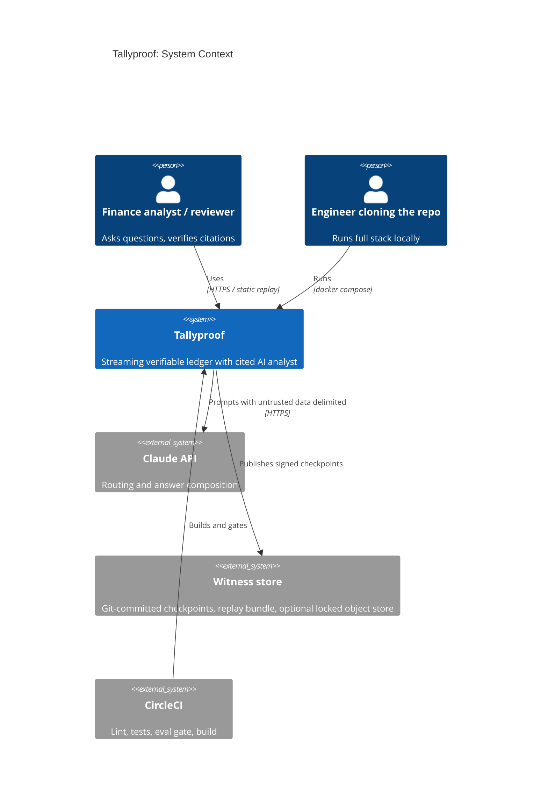
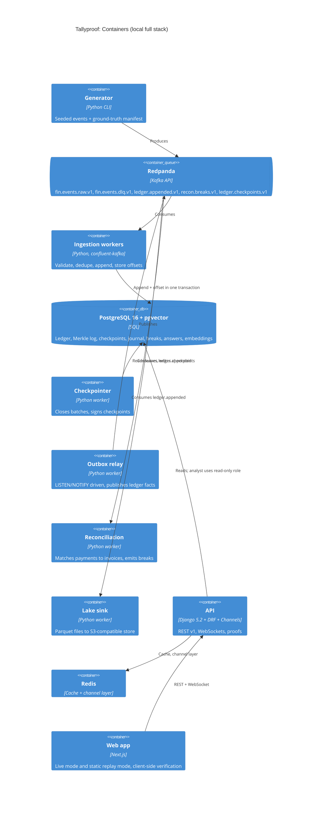
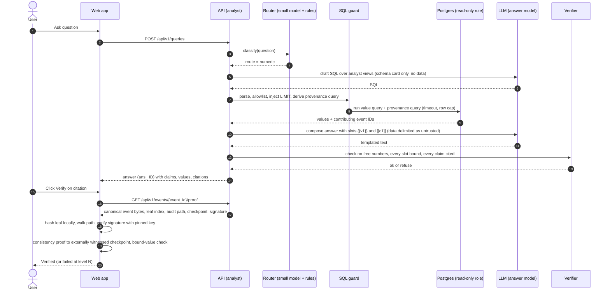

# 07. Architecture

> Status: Draft for MC-01. Diagrams below are hand-written Mermaid drafts. Final versions will be produced with the diagram skill approved at MC-08 (REQ-DOC-04).

## 1. System overview

Tallyproof is a streaming pipeline with a verifiable ledger at its center and an AI analyst on top.

1. **Generator** produces seeded synthetic finance events and a separate ground-truth manifest.
2. **Redpanda** (Kafka API) carries events, partitioned by account.
3. **Ingestion workers** validate, deduplicate, and append events to the ledger inside one Postgres transaction that also stores the consumer offset.
4. **Ledger** is append-only. Each accepted event becomes a leaf in a Merkle log.
5. **Checkpointer** closes batches by size or time and signs a checkpoint (tree size, root hash) with Ed25519.
6. **Witness export** publishes checkpoints outside the database (repo file, replay bundle, optionally object storage with retention lock).
7. **Outbox relay** publishes `ledger.appended` facts for downstream consumers: reconciliation, journal, lake sink, realtime UI.
8. **Analyst** answers questions using bound values from guarded SQL and quotes from retrieved policy documents. Every claim carries citations; the client fetches proofs and verifies.
9. **Evals** compare answers against the ground-truth manifest using an independent oracle.
10. **Frontend** runs live (WebSockets) or in replay mode (static bundle, in-browser verification).

## 2. C4 Context (draft)

## 3. C4 Container (draft)

## 4. Key flows

### 4.1 Ingestion (effectively-once)

1. Consumer polls a batch of up to `INGEST_MAX_BATCH` records from `fin.events.raw.v1`.
2. Each record is parsed and validated against the Pydantic schema for its `event_type` and `schema_version`. Failures go to `fin.events.dlq.v1` with an error envelope; the offset still advances (poison messages must not block a partition).
3. Dedupe. Each key is checked against the per-partition Bloom filter and then added to it immediately, so two copies inside one poll are caught.
   - The batch is staged with `COPY` into a temporary table, then moved with `INSERT ... SELECT ... ON CONFLICT (idempotency_key) DO NOTHING RETURNING`. The database UNIQUE constraint is always the authority; nothing aborts the transaction on a duplicate.
   - Keys the Bloom filter reports as "maybe seen" are recorded in `dedupe_rejection` when the insert confirms the conflict, and counted as Bloom false positives when it does not.
4. Leaf indexes are assigned **after** the insert set is final, from a single-row counter (`UPDATE merkle_log_head SET next_index = next_index + $n RETURNING ...`) in the same transaction. The row lock serializes writers, and a rollback restores the counter, so the log can never have gaps. Sequences are not used because `nextval` is not transactional. A checkpointer assertion checks `max(leaf_index) + 1 = count(*)`.
5. The same transaction upserts `consumer_offset(group, topic, partition, next_offset)` with `next_offset = GREATEST(existing, new)` plus a consumer generation check, so a zombie consumer after a rebalance cannot move offsets backwards. Outbox rows are inserted in the same transaction.
6. Commit. Only then is the Kafka offset committed (for monitoring). On restart, the consumer seeks to offsets stored in Postgres, not in Kafka. This is why processing is effectively-once even though delivery is at-least-once.

### 4.2 Checkpointing

A batch closes when `MERKLE_BATCH_MAX_SIZE` leaves have accumulated or `MERKLE_BATCH_MAX_AGE_MS` has elapsed since the batch opened, whichever comes first (ADR-0003). Closing a batch:

1. Computes the RFC 9162 root over the whole log `[0, tree_size)`.
2. Builds a checkpoint body in the C2SP `tlog-checkpoint` text format (origin line, tree size, base64 root).
3. Signs it with Ed25519 (`CHECKPOINT_SIGNING_KEY` from `.env`).
4. Stores it as `ledger_batch` (`bat_` ID), publishes to `ledger.checkpoints.v1`, and appends it to the witness export.

### 4.3 Question to verified answer

## 5. Component responsibilities

| Component | Owns | Does not own |
|---|---|---|
| `core` (framework-free library) | Canonical JSON, hashing, Merkle log math, Bloom filter, ID minting, money type | Django, I/O |
| `events` | Pydantic event schemas, JSON Schema export, topic registry | Persistence |
| `generator` | Scenarios, anomaly injection, manifest | Ingestion |
| `ingestion` | Consumers, validation, dedupe, DLQ, offset storage | Merkle math |
| `ledger` | Event store, leaves, batches, checkpoints, proofs, outbox, journal | Reconciliation rules |
| `reconciliation` | Matching rules, break types, break store | Ledger writes |
| `analyst` | Router, SQL guard, retrieval, composer, verifier, LLM interface | Proof verification (client does that) |
| `evals` | Golden sets, oracle, runner, metrics, thresholds | System under test internals |
| `lake` | Parquet sink, control totals | Ledger |
| `realtime` | WebSocket fan-out of ledger facts | Business logic |
| `web` (Next.js) | UI, client-side verification library mirrored from `core` | Trusting the server |

The client verification library in TypeScript is a deliberate second implementation of the Merkle verification and canonical JSON logic. Cross-language test vectors (generated by Python, checked by Vitest) keep them in lockstep.

## 6. Data and consistency model

### 6.1 Canonical bytes
Every leaf is `SHA-256(0x00 || canonical_bytes)` where `canonical_bytes` is the RFC 8785 (JCS) serialization of the event envelope minus transport-only fields. Money is serialized as a decimal string, never a float, so Python and the browser hash identical bytes. Interior nodes are `SHA-256(0x01 || left || right)`. Domain separation prevents second-preimage attacks where an interior node is passed off as a leaf. Odd nodes are handled per RFC 9162 (split at the largest power of two), not by duplicating the last node, which avoids the duplicate-leaf ambiguity known from Bitcoin's CVE-2012-2459.

### 6.2 Ordering
- Kafka guarantees order per partition only. Partition key is `account_id`, so all events for one customer or vendor are ordered relative to each other, which reconciliation needs.
- The Merkle log has a single global order (`leaf_index`), assigned at commit time. This is **ingestion order**, not event time. Late-arriving events get a later `leaf_index` but keep their original `occurred_at`. Reconciliation and analytics use `occurred_at`; proofs use `leaf_index`.
- One log writer at a time (row lock on `merkle_log_head`). With N partitions and N consumers this is the throughput ceiling of the design and is measured in the load test. Sharding the log per partition is the documented scale-out path (section 9).

### 6.3 Immutability
- `ledger_event`, `ledger_batch`, `journal_line` have no UPDATE or DELETE grant for the application role, and a trigger raises on UPDATE or DELETE as defense in depth.
- Corrections are new events (`adjustment.posted`, reversing journal entries), never edits.

## 7. Tamper ladder (what each mechanism catches)

Superseded in detail by ADR-0015, which corrected an earlier draft that relied on a server-supplied leaf hash and a same-origin key.

| Level | Attacker | Fails at |
|---|---|---|
| 1 | Edits a stored event (any column) | Bound-value check against verified canonical bytes, or leaf recomputed in the browser no longer reproduces the root |
| 2 | Edits the event and rebuilds the tree, cannot sign | Checkpoint signature against the key pinned in the web build |
| 3 | Edits, rebuilds, and re-signs with a stolen key | Consistency proof against the externally timestamped checkpoint |
| 4 | As 3, before the next external timestamp | **Not detectable.** Window equals `WITNESS_INTERVAL_SECONDS`. Stated in the README |

The public demo walks levels 1 to 3 in the browser using a separate, published demo key in a labeled demo log. Level 4 is explained, not demonstrated.

## 8. Known limits of the verification model

- **Completeness:** an inclusion proof shows an event is in the log; it does not show that an aggregate used *all* relevant events. Mitigations: (a) the provenance query returns the contributing set and the browser recomputes the aggregate from it; (b) in replay mode the full log is present, so the browser can recompute the query itself; (c) Nice-to-have: Merkle-sum tree per account so totals are provable. Until (c), the UI labels aggregates as "recomputed from N cited events", not "proven complete".
- **Semantic faithfulness of narrative text:** quotes are checked exactly, numbers are bound, but the connecting prose is checked by evals (LLM-judge on the narrative subset), not by cryptography.
- **Generator honesty:** the system proves records are untampered since ingestion, not that they were true at the source.

## 9. Scaling discussion and honest limits

| Concern | Current design | Measured? | Scale-out path |
|---|---|---|---|
| Ingest throughput | N consumers, single log writer | Yes, load test (MLP) | Shard Merkle log per partition; top-level log of shard heads |
| Proof generation | Computed from leaf hashes with cached complete subtrees | Yes, p95 latency in report | Persist interior nodes; tile-based layout (transparency.dev tiles) served from object storage |
| Postgres size | Single node | Reported row counts | Time partitioning of `ledger_event`; cold data to lake |
| Kafka | 6 partitions locally | Lag metric in report | More partitions; MSK in AWS mapping |
| Analyst latency | Two LLM calls plus SQL | p50/p95 in eval report | Cache, smaller router, streaming responses |

We publish only measured numbers, with hardware and configuration stated (Section 14 of the brief).

## 10. Failure modes and recovery

| Failure | Effect | Recovery |
|---|---|---|
| Consumer crash mid-batch | Transaction rolled back | Restart seeks to Postgres-stored offset; at-least-once delivery plus idempotent append |
| Bloom filter lost on restart or partition reassigned | Higher false-positive work only; correctness unaffected because the UNIQUE constraint is the authority | Rebuild the filter in `on_assign` from `ledger_event` rows for that partition before the first poll (index on `kafka_partition`) |
| Poison message | Would block partition | DLQ with error envelope; replay tool after fix |
| Signing key missing | Cannot close batches | Fail fast at startup (REQ-SEC-02); ingestion continues, checkpoint lag alarm |
| Redpanda down | No ingestion | `/readyz` fails; producers retry with backoff; no data loss once acked |
| Postgres down | No ingestion or answers | `/readyz` fails; consumers pause |
| LLM unavailable or over budget | No new answers | Analyst returns typed refusal "service unavailable"; cached answers still served; replay mode unaffected |
| Outbox relay lag | Downstream stale | Lag metric; relay is idempotent by outbox ID |
| Lake sink failure | Lake behind ledger | Control totals job flags mismatch; sink resumes from its own offsets |

## 11. Deployment views

- **Local full stack (REQ-OPS-01):** `docker compose` brings up Redpanda, Redpanda Console, Postgres+pgvector, Redis, object store, API, workers, web.
- **Public replay demo (REQ-OPS-02):** static Next.js export plus a replay bundle (events, checkpoints, proofs, precomputed answers, eval results, public key). Verification runs in the browser. Hosted on Vercel; also buildable for GitHub Pages as a fallback.
- **Optional live backend (REQ-OPS-03):** documented, never required.
- **AWS reference (not deployed):** `15-aws-reference-architecture.md`.
