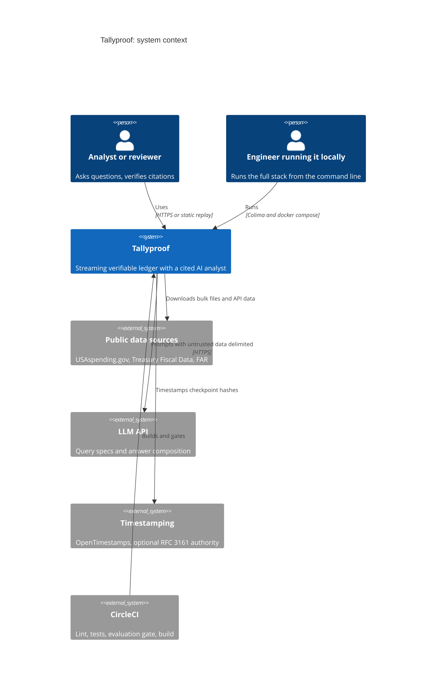
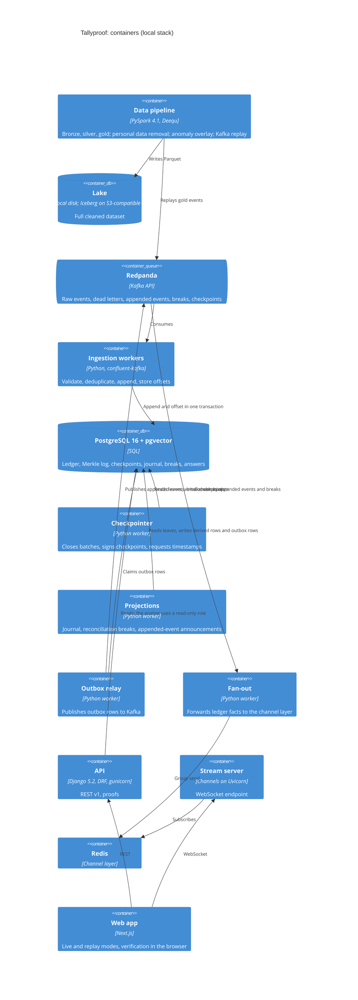
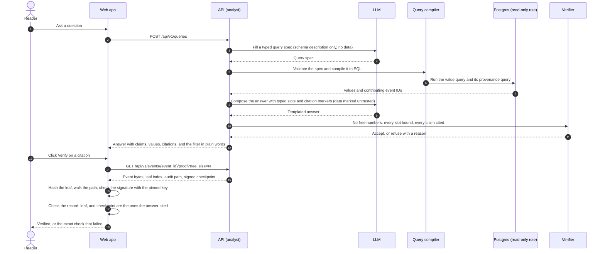

# Architecture

Tallyproof is a data pipeline with a verifiable ledger in the middle and an AI analyst on top. Real public spending data is cleaned in batch, streamed through Kafka into an append-only ledger, and committed to a Merkle log whose checkpoints are signed and timestamped outside the system. When the analyst answers a question, each value comes from a query and each claim carries a proof the reader's browser can check.

The diagrams are Mermaid and live in this file, so they change in the same commit as the code they describe.

## Overview

1. The **data pipeline** downloads official bulk files, cleans them with Spark in bronze, silver, and gold layers, removes personal data, checks quality with Deequ, and injects a seeded, labeled set of anomalies whose labels are stored separately ([ADR-0016](adr/0016-real-public-data-sources.md), [ADR-0017](adr/0017-spark-batch-processing-and-deequ.md)).
2. **Redpanda**, a Kafka-compatible broker, carries the events, partitioned by recipient.
3. **Ingestion workers** validate and deduplicate events, then append them to the ledger in the same Postgres transaction that records the consumer offset.
4. The **ledger** is append-only. Each accepted event becomes a leaf in a Merkle log.
5. The **checkpointer** closes a batch by size or time and signs a checkpoint (tree size and root hash) with Ed25519.
6. **Witnesses** keep copies of checkpoints outside the database, and an external timestamp proves when each one existed.
7. **Projections** read the ledger in leaf order and build derived state: the double-entry journal, reconciliation breaks, and an announcement for each appended event. Each projection keeps a cursor that moves in the same transaction as what it writes, so a crash never skips or repeats an event.
8. An **outbox relay** publishes announcements to Kafka, and a **fan-out worker** pushes them to browsers over WebSockets.
9. The **analyst** answers questions with values bound from compiled queries and quotes from policy documents. Every claim carries citations, and the client verifies them.
10. **Evaluation** compares answers with exact expected results computed independently of the analyst.
11. The **web app** runs against the live stack over WebSockets, or as a static replay of a recorded run that still verifies every proof in the browser.

## System context

## Containers

## Main flows

### Ingestion, processed effectively once

Kafka delivers at least once, so correctness comes from an idempotent, transactional sink.

1. A consumer polls up to `INGEST_MAX_BATCH` records from the raw events topic.
2. Each record is validated against the schema for its event type and version. Invalid records go to the dead-letter topic with an error envelope, and the offset still advances so one bad message can't block a partition.
3. Each idempotency key is checked against a per-partition Bloom filter and added to it right away, which also catches two copies inside a single poll. The batch is passed as arrays and inserted with `INSERT ... SELECT FROM unnest(...) ON CONFLICT (idempotency_key) DO NOTHING RETURNING`. The unique constraint is always the authority, and a duplicate never aborts the transaction ([ADR-0008](adr/0008-effectively-once-ingestion.md)).
4. Leaf indexes are assigned after the insert set is final, from a single-row counter updated in the same transaction. The row lock serializes writers, and a rollback restores the counter, so the log can't develop gaps. Postgres sequences aren't used, because `nextval` isn't transactional.
5. The same transaction stores the consumer offset with `GREATEST(existing, new)` and a generation check, so a stale consumer after a rebalance can't move offsets backwards. The commit sends a `ledger_appended` notification that wakes the checkpointer and the projections.
6. After commit, the offset is also committed to Kafka for monitoring. On restart, consumers seek to the offsets stored in Postgres.

### Checkpointing

A batch closes when `MERKLE_BATCH_MAX_SIZE` leaves have accumulated or `MERKLE_BATCH_MAX_AGE_MS` has passed, whichever comes first ([ADR-0003](adr/0003-merkle-batching-strategy.md)). Closing a batch computes the RFC 9162 root over the whole log, writes a C2SP checkpoint (origin, tree size, root), signs it, stores and publishes it, and requests an external timestamp for its hash ([ADR-0007](adr/0007-signed-checkpoints-and-witnessing.md)).

### Projections and the outbox

Derived state is never written by ingestion. Each projection (`appended`, `journal`, `reconciliation`) reads leaves after its cursor in `projection_cursor`, writes its rows, and moves the cursor in one transaction. Rebuilding one from scratch is a matter of clearing its rows and its cursor and running it again, which `make rebuild-derived` does and which gives identical results.

Projections that announce something write an `outbox` row in the same transaction and send an `outbox_ready` notification. The relay claims rows with `SELECT ... FOR UPDATE SKIP LOCKED`, publishes them, and marks them sent. Delivery is at least once, so every message carries its outbox ID in a header for consumers to deduplicate. The checkpointer announces each signed checkpoint the same way.

Nothing polls: the checkpointer, the projections, and the relay all wait on Postgres `LISTEN`, with a timeout only as a safety net.

### Live stream

The fan-out worker consumes `ledger.appended.v1` and `recon.breaks.v1` and sends small facts (event ID, leaf index, type, amount, or the break) to a Channels group through Redis. The stream server, Channels on Uvicorn, accepts WebSocket connections only when the `Origin` header names a host in `DJANGO_ALLOWED_HOSTS`, and forwards the group's messages. The channel layer drops messages for a client that can't keep up, so a browser that falls behind reconnects and reads current state over REST. The stream is for watching, not for proofs.

### From question to verified answer

Numeric questions go through a constrained query spec rather than free-form SQL, so every answer shape has a defined set of contributing records ([ADR-0014](adr/0014-constrained-query-ir.md)). The model never writes a number; values are bound from query results ([ADR-0009](adr/0009-bound-claims-answer-format.md)).

## Components

| Component | Responsible for | Not responsible for |
|---|---|---|
| `core` (no framework) | Canonical JSON, hashing, Merkle log, consistency proofs, checkpoints, Bloom filter, IDs, money | Django, I/O |
| `pipeline` | Downloads, Spark jobs, personal data removal, quality checks, anomaly overlay, Kafka replay | The ledger |
| `events` | Event schemas, JSON Schema export, topic registry | Storage |
| `ingestion` | Consumers, validation, deduplication, dead letters, offsets | Merkle math |
| `ledger` | Event store, leaves, batches, checkpoints, proofs, projections, outbox, journal | Reconciliation rules |
| `reconciliation` | Matching rules and break records | Ledger writes |
| `analyst` | Query compiler, retrieval, answer composer, verifier, LLM client | Proof verification, which the client does |
| `evals` | Question sets, oracle, runner, metrics, thresholds | Analyst internals |
| `realtime` | WebSocket fan-out | Business logic |
| `web` | UI and the browser verification library | Trusting the server |

The TypeScript verification library is a deliberate second implementation of the canonical JSON and Merkle logic. Test vectors generated by the Python code and checked by the TypeScript tests keep the two in step.

## Data and consistency

### Canonical bytes

Each leaf is `SHA-256(0x00 || canonical_bytes)`, where the bytes are the RFC 8785 serialization of the event. Interior nodes are `SHA-256(0x01 || left || right)`. The prefixes stop an interior node from being passed off as a leaf. When a level has an odd number of nodes, the tree splits at the largest power of two, as RFC 9162 specifies, instead of duplicating the last node, which avoids the ambiguity behind Bitcoin's CVE-2012-2459.

Money is always a decimal string, never a float, so Python and the browser hash identical bytes. The stored canonical bytes are the single source of truth: the queryable `payload` column is generated from them, so the analyst can't read anything the proof doesn't cover ([ADR-0015](adr/0015-verification-trust-model.md)).

### Ordering

Kafka orders events within a partition only. Events are keyed by recipient, so everything for one vendor stays in order, which reconciliation depends on.

The Merkle log has one global order, assigned at commit. That's ingestion order, not event time: a late event gets a later leaf index but keeps its original timestamp. Reconciliation and analytics use event time; proofs use leaf index.

Only one writer appends to the log at a time. With N partitions and N consumers, that's the throughput ceiling of the design. The load test measures it, and the way past it is to shard the log by partition under a top-level log of shard heads.

### Immutability

The application role has no update or delete grants on the append-only tables, triggers reject updates and deletes as a second layer, and `TRUNCATE` is revoked. Corrections are new events, such as a de-obligation, or reversing journal entries. Nothing is edited in place.

## Tamper detection

The browser trusts one thing today: a release public key compiled into the web build. From that it checks the record's bytes, the leaf hash, the inclusion proof, and the checkpoint's signature itself. The design adds a second anchor, a checkpoint timestamped by a third party, checked through a consistency proof; today that check runs in `make verify-witness` and the integration tests, and moving it into the browser is planned with the site ([ADR-0015](adr/0015-verification-trust-model.md)).

| Level | What the attacker can do | What catches it | Where it's checked today |
|---|---|---|---|
| 1 | Edit a stored event | The recomputed leaf no longer reproduces the signed root | In the browser, and in the integration tests |
| 2 | Edit the event and rebuild the tree, without the signing key | The checkpoint signature fails against the pinned key | In the browser, and in the integration tests |
| 3 | Edit, rebuild, and re-sign with a stolen key | The consistency proof against the externally timestamped checkpoint fails | `make verify-witness` and the integration tests; the browser check is planned |
| 4 | All of the above, before the next external timestamp | Not detectable. The window is `WITNESS_INTERVAL_SECONDS`, and the README says so | |

`make tamper LEVEL=1`, `2`, or `3` carries out each attack on a local ledger, and `make tamper RESTORE=1` puts it back; integration tests show each level is caught by the check in this table. The public demo lets you edit a record's amount, and rebuild the tree around the edit, in the browser, which demonstrates levels 1 and 2. Level 3 in the browser comes with the planned consistency check; level 4 is explained, not demonstrated.

## Known limits

What was scaled down to run on one laptop and free tiers, and how to run each part at full scale, is in [limitations](limitations.md). The limits below are about the design itself.

- **Completeness.** An inclusion proof shows a record is in the log. It doesn't show an aggregate used every relevant record. The query spec defines which records contribute to each answer shape, pins the query to a checkpoint, and shows the filter in plain words; every contributing record is cited, and each can be verified. A total built from more than 1,000 records (`DB_ANALYST_MAX_ROWS`) is still computed over all of them, but its citation lists only the first 1,000 in log order and says how many the total covers, so the reader can verify a sample, not the whole. Until a Merkle-sum tree makes totals provable, no aggregate is described as proven complete.
- **Narrative text.** Quotes are checked exactly and numbers are bound, but the prose connecting them is scored by evaluation, not by cryptography.
- **Source honesty.** The system proves a record is unchanged since ingestion. It can't prove the government recorded it correctly.
- **Reconciliation on a slice.** The rules see only what's in the ledger. An award obligated before the replayed slice starts has no obligation on record, so its de-obligations and outlays look wrong. Break counts from real data are reported with that caveat, separately from the labeled anomalies.
- **The lake versus the ledger.** The lake holds the full dataset. The verifiable ledger holds a replayed slice, a million events by default.

## Scaling

| Concern | Current design | How it's measured | Path beyond it |
|---|---|---|---|
| Ingest throughput | N consumers, one log writer | Load test | Shard the log per partition |
| Proof generation | Computed from leaf hashes | p95 latency in the load test | Persist interior nodes; serve tiles from object storage |
| Batch processing | Spark in local mode, one 2 GB file at a time | Job timings in the data profile | A Spark cluster such as EMR or Glue |
| Postgres size | Single node | Row counts | Time partitioning; cold data stays in the lake |
| Kafka | 6 partitions locally | Consumer lag | More partitions, Amazon MSK |
| Analyst latency | Two LLM calls and a query | p50 and p95 in evaluation reports | Caching and streamed responses |

Only measured numbers get published, with hardware and configuration stated.

## Failure modes

| Failure | Effect | Recovery |
|---|---|---|
| Consumer crashes mid-batch | Transaction rolls back | Restart seeks to the offset stored in Postgres |
| Bloom filter lost or partition reassigned | More duplicate checks, no correctness impact | Rebuilt from the ledger for that partition before the first poll |
| Malformed message | Would block a partition | Dead-letter topic with an error envelope, replay after the fix |
| Signing key missing | Batches can't close | The checkpointer refuses to start; ingestion continues and checkpoint lag is alerted |
| Redpanda down | No ingestion | `/readyz` fails, producers retry with backoff |
| Postgres down | No ingestion or answers | `/readyz` fails, consumers pause |
| LLM unavailable or over budget | No new answers | Typed refusal; cached answers and replay mode keep working |
| Outbox relay behind | Downstream views are stale | Unsent rows wait in the outbox; consumers deduplicate by outbox ID |
| A projection fails on an event | That projection stops at the event; the others continue | Its cursor didn't move, so it retries from the same leaf after the fix, or is rebuilt |
| Redis down or a browser too slow | Live updates stop or skip | The stream is best effort; the browser reconnects and reads state over REST |
| Lake sink behind (planned) | Lake trails the ledger | Control totals flag the gap; the sink resumes from its offsets |

## Deployment

- **Local full stack:** Colima and `docker compose` from the command line bring up Redpanda, Postgres with pgvector, and Redis. The API, the stream server, and the workers (ingestion, checkpointer, projections, relay, fan-out) run as host processes to save VM memory, and `make demo` starts them all. Spark runs separately, while the stack is stopped ([runbook.md](runbook.md)).
- **Public demo:** a static Next.js export with a signed bundle of a recorded run. Verification happens in the browser and nothing needs a server ([ADR-0005](adr/0005-replay-mode-public-demo.md)).
- **AWS mapping:** how each part would run on AWS is in [aws-reference-architecture.md](aws-reference-architecture.md).
