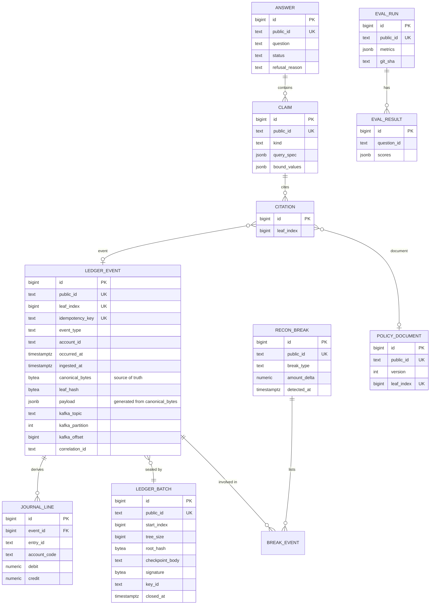

# Backend design

This document describes the repository layout, the events and their schemas, the Kafka topics, the database, and the API. The overall system is described in [architecture.md](architecture.md).

## Repository layout

```
tallyproof/
  backend/
    pyproject.toml            ruff, mypy, pytest, and coverage settings
    requirements.in           direct runtime dependencies
    requirements-dev.in       direct development dependencies
    requirements.txt          pinned with hashes by pip-tools
    requirements-dev.txt      pinned with hashes by pip-tools
    manage.py
    config/                   Django project
      settings/               base, local, test, and ci settings
      env.py                  typed settings loaded from .env
    tallyproof_core/          plain Python, no Django
      canonical.py            RFC 8785 serialization
      hashing.py              leaf and node hashing with domain separation
      merkle.py, log_tree.py  inclusion and consistency proofs; cached tree for large logs
      checkpoint.py           C2SP signed checkpoints, Ed25519
      events.py               event envelope and payload schemas
      journal.py              double-entry lines for one event
      reconciliation.py       reconciliation rules over the ordered log
      bloom.py                Bloom filter and its sizing math
      ids.py                  prefixed public IDs
      money.py                Decimal money
    tallyproof_pipeline/      Spark jobs and producers, also free of Django
      acquire.py              downloads with a source manifest
      silver.py               typing, cleaning, personal data removal, quarantine
      quality.py              Deequ constraints and metrics history
      gold.py, overlay.py     conformed events and the labeled anomaly overlay
      stream.py               Kafka producer for gold events
      treasury.py             Treasury daily statement connector
      policy.py               FAR sections from eCFR as policy events
    corpus/far/               the committed FAR policy corpus and its manifest
    schemas/                  the exported event JSON Schema
    apps/                     Django apps
      ingestion/              consumer loop, validation, deduplication, dead letters, schema registry
      ledger/                 event store, Merkle log, checkpoints, proofs, projections, outbox, journal
      reconciliation/         break records and their API
      realtime/               WebSocket consumer and the fan-out worker
      health/                 /healthz and /readyz
      analyst/, evals/        the AI analyst and its evaluation (next phase)
    tests/                    unit, module, integration, and end-to-end tests
  frontend/                   Next.js app
  infra/                      compose file, database role script, topic setup
  testdata/                   shared cross-language vectors and the CI data sample
  docs/
  .circleci/
  Makefile
```

`tallyproof_core` and `tallyproof_pipeline` are kept free of Django on purpose. The hashing and Merkle code is what a careful reader will scrutinize most, and in plain Python it's easier to read, to test with property-based tests, and to mirror in TypeScript. The Spark jobs don't need a web framework either.

Downloaded data lives in `data/`, which git ignores. Every app has its own README covering what it does, its public interface, and the events it consumes and produces.

## Public IDs

Public IDs look like `<prefix>_<ULID>`: sortable and safe in URLs. Internal integer keys never leave the service.

| Prefix | Entity |
|---|---|
| `evt_` | Ledger event |
| `bat_` | Merkle batch, closed by a checkpoint |
| `src_` | Registered source file (a downloaded archive and its hash) |
| `brk_` | Reconciliation break |
| `doc_` | Policy document version |
| `qry_` | Submitted question |
| `ans_` | Answer |
| `clm_` | Claim within an answer |
| `run_` | Evaluation run |

Business identifiers from the source data, such as award keys and recipient UEIs, are kept as they are inside the event payload. A UEI identifies a registered business entity. Awards to individual people are removed during cleaning, so no personal identifier reaches the ledger.

## Events

### Envelope

```text
EventEnvelope
  event_id          evt_...   unique per emission; a re-delivered duplicate gets a new one
  idempotency_key   str       the logical identity of the event; duplicates share it
  event_type        enum      see the table below
  schema_version    int       starts at 1
  occurred_at       datetime  when it happened (UTC, RFC 3339)
  emitted_at        datetime  when it was produced; a large gap marks a late arrival
  account_id        str       the recipient UEI, or a Treasury account for cash events
  correlation_id    str       traces one event from ingestion to the answer that cites it
  payload           one schema per event type
```

| Event type | Source | Key payload fields |
|---|---|---|
| `obligation.recorded` | USAspending contract transaction with a positive amount | award key, PIID, awarding and funding agency, amount, action date, action type, NAICS and PSC codes, description |
| `obligation.adjusted` | Modification, including de-obligations (negative amounts) | award key, modification number, amount, reason |
| `outlay.reported` | Account-level award financial data | award key, Treasury account, fiscal period, cumulative outlay, period outlay (derived) |
| `cash.movement` | Treasury Daily Treasury Statement | record date, account, deposit or withdrawal, category, amount and its unit |
| `source.registered` | The acquisition step | file name, URL, size, SHA-256, fetch time |
| `policy.published` | One FAR section from eCFR | citation, section, title, edition date, full text |

A policy event carries the whole section, so a quote can be checked against the proven leaf rather than against a copy served separately. Its idempotency key includes a hash of the text: an amended section becomes a new leaf, and republishing an unchanged one is refused as a duplicate.

Outlays in the source are cumulative from the start of the fiscal year. The cleaning step derives each period's outlay as the difference from the previous period for the same award and account, and quarantines rows where that goes negative without a matching correction.

Event schemas are Pydantic models exported as JSON Schema draft-07 with internal references only, so they work in both Redpanda's Schema Registry and AWS Glue Schema Registry. Schemas are registered with backward compatibility enforced.

### What gets hashed

The hashed leaf document contains exactly these fields: `event_id`, `idempotency_key`, `event_type`, `schema_version`, `occurred_at`, `emitted_at`, `account_id`, and `payload`. Tracing fields and Kafka coordinates are left out so they can never change a proof.

Three validation rules keep Python and the browser producing identical bytes. Events that break them go to the dead-letter topic.

- The only JSON numbers allowed are integers from 0 up to 2^53. Money, rates, and quantities are decimal strings.
- Every string must be valid Unicode with no lone surrogates. The injected prompt-injection cases deliberately include zero-width and right-to-left characters, and they're part of the shared test vectors.
- IDs are minted from an injectable clock and a seeded random generator, so a seed reproduces the same IDs.

### Labels stay out of events

Anomaly labels are written to a separate manifest keyed by `event_id`, and only the evaluation harness reads it. If labels were in the events, the analyst could read the answer key and evaluation would mean nothing.

## Anomaly catalog

Injected anomalies are seeded and deterministic. Anomalies that occur naturally in the government data are found by documented rules and reported separately, so the two are never mixed.

| Label | What's injected | Caught by | Expected result |
|---|---|---|---|
| `duplicate_delivery` | The same event re-sent | Ingestion deduplication | Rejected and logged |
| `duplicate_award_semantic` | Same recipient, amount, and date under a different award number | Reconciliation | `possible_duplicate_award` break |
| `outlay_exceeds_obligation` | Outlays pushed above the award's total obligations | Reconciliation | `outlay_exceeds_obligation` break |
| `orphan_outlay` | An outlay for an award that was never obligated | Reconciliation | `orphan_outlay` break |
| `deobligation_exceeds_award` | A de-obligation larger than the amount obligated | Reconciliation | `deobligation_exceeds_award` break |
| `late_arrival` | An event emitted long after it occurred, possibly after its period closed | Reconciliation watermark | `late_after_close` break, posted to the open period |
| `injection_description` | Instructions aimed at the LLM inside a description field | Analyst defenses | Answer unaffected; measured in evaluation |
| `schema_invalid` | A malformed event | Ingestion validation | Dead-letter topic |
| `recipient_burst` | Eight new small awards to one recipient, five minutes apart, each with a different amount | Heavy-hitter detection (later) | Flagged |

Injected outlays borrow a Treasury account from a real outlay in the stream when there is one. Every label is injected in each build; the scenario (`DATA_SCENARIO`) sets how many of each and how many real events surround them.

Periods are fiscal months. A period closes when the watermark, the latest event time seen minus `RECON_LATE_ARRIVAL_WATERMARK_HOURS`, passes its end. Late events post to the open period with a reference to the closed one; closed periods are never edited.

## Kafka topics

Topics are named `<domain>.<entity>.<stage>.v<major>`.

| Topic | Key | Local partitions | Retention | Producer | Consumers |
|---|---|---|---|---|---|
| `fin.events.raw.v1` | `account_id` | 6 | 7 days | replay producer, live connector | ingestion |
| `fin.events.dlq.v1` | `account_id` | 1 | 30 days | ingestion | replay tool |
| `ledger.appended.v1` | `account_id` | 6 | 7 days | outbox relay, from the `appended` projection | realtime fan-out, outside consumers |
| `ledger.checkpoints.v1` | log origin | 1 | compacted | outbox relay, from the checkpointer | realtime fan-out, witnesses |
| `recon.breaks.v1` | `account_id` | 3 | 7 days | outbox relay, from the `reconciliation` projection | realtime fan-out |

The journal and reconciliation don't consume Kafka. They're projections that read the ledger in leaf order with a cursor stored in the same transaction as their output ([ADR-0019](adr/0019-projections-read-the-ledger.md)). Every message the relay publishes carries an `outbox-id` header, since delivery is at least once.

Events are keyed by recipient because reconciliation works per award and recipient, so ordering matters there. Duplicates share a key, which puts them on the same partition, where the per-partition Bloom filter can see both. A recipient with a very large share of events can skew partitions. The load test reports partition balance.

## Database

PostgreSQL 16 with pgvector. The diagram shows the whole design. The ledger, batch, journal, break, and outbox tables exist today; `POLICY_DOCUMENT`, `ANSWER`, `CLAIM`, `CITATION`, and the evaluation tables arrive with the analyst.



Supporting tables: `merkle_log_head` (a single row holding the next leaf index), `consumer_offset`, `dedupe_rejection`, `outbox`, `projection_cursor` (one row per projection), `break_event` (which events a break involves, and in what role), and, in the next phase, `doc_chunk` with a 384-dimension embedding column.

Constraints worth knowing about:

- `payload` is a stored generated column computed from `canonical_bytes`. Analyst views read `payload`, so changing what the analyst sees means changing the bytes the proof covers.
- Money is `NUMERIC(19,4)`. A journal line has either a debit or a credit, never both, and a deferred trigger makes every entry balance.
- `idempotency_key` and `leaf_index` are unique, and leaf indexes are contiguous.
- The application role can't update, delete from, or truncate the append-only tables, and triggers reject updates and deletes as a second layer.
- Each schema change is its own migration, reviewed on its own.

The journal uses simplified budgetary accounting: an obligation moves funds from available authority to obligated, an outlay moves them from obligated to disbursed, and a de-obligation reverses the first step. It's derived from events in log order, so it can always be rebuilt ([ADR-0013](adr/0013-double-entry-journal.md)).

### Roles

| Role | Can do |
|---|---|
| `tallyproof_owner` | Owns the schema and runs migrations, through its own connection string |
| `tallyproof_app` | Insert and select on ledger tables; no update, delete, or truncate on append-only tables |
| `tallyproof_analyst` | Select on the `analyst` views only, read-only transactions, tight timeouts |

Roles are created by a script that runs the same way locally and in CI. Grants live in an idempotent migration with default privileges, so tables created later inherit them.

### Analyst views (planned)

These are built with the analyst: `analyst.obligations`, `analyst.outlays`, `analyst.awards` (one row per award with totals), `analyst.cash_movements`, `analyst.breaks`, and `analyst.journal`. Every view exposes `event_id`, so each answer can cite the records behind it. Raw bytes, Kafka coordinates, and internal IDs stay hidden, and free-text description columns appear only in a separate view the query compiler must request explicitly.

## API

All endpoints except the health checks are under `/api/v1/` and return JSON. The OpenAPI schema is at `/api/v1/schema/`, with browsable docs at `/api/v1/docs/`. Errors use RFC 9457 problem details.

| Method | Path | Purpose |
|---|---|---|
| GET | `/api/v1/log-key` | The log origin and the verifier key every checkpoint is signed with |
| GET | `/api/v1/events` | Events in log order, cursor-paginated (`limit` up to 200), filterable by `event_type` and `account_id` |
| GET | `/api/v1/events/{event_id}` | One event with its canonical bytes and leaf index |
| GET | `/api/v1/events/{event_id}/proof` | Inclusion proof against the newest checkpoint, or the one at `?tree_size=` |
| GET | `/api/v1/checkpoints` | Signed checkpoints, newest first |
| GET | `/api/v1/checkpoints/latest` | The newest signed checkpoint |
| GET | `/api/v1/checkpoints/{tree_size}` | The checkpoint signed at one tree size |
| GET | `/api/v1/consistency?first={size}&second={size}` | Proof that the second checkpoint extends the first |
| GET | `/api/v1/batches/{batch_id}/consistency` | Proof that a batch's checkpoint extends the one before it; 409 for the first batch |
| GET | `/api/v1/reconciliation/breaks` | Breaks in the order found, filterable by `break_type` and `award_key` |
| GET | `/api/v1/reconciliation/breaks/{break_id}` | One break and the events involved, with their roles |
| GET | `/healthz` | Liveness, no dependencies |
| GET | `/readyz` | Checks the database and the broker; 503 names whichever is down |

Planned with the analyst and evaluation work:

| Method | Path | Purpose |
|---|---|---|
| POST | `/api/v1/queries` | Ask a question. Rate limited |
| GET | `/api/v1/answers/{answer_id}` | An answer with its claims, bound values, and citations |
| GET | `/api/v1/policy-documents/{document_id}` | A policy section and its leaf index |
| GET | `/api/v1/eval-runs`, `/api/v1/eval-runs/{run_id}` | Evaluation runs and their per-question results |

Live updates stream over the WebSocket at `/ws/v1/stream`, served separately by `make stream`: appended events, signed checkpoints, and breaks. A client that falls behind receives `{"kind": "facts_dropped", "count": n}` and should re-read state over REST.

A proof response looks like this:

```json
{
  "event_id": "evt_01J...",
  "leaf_index": 4211,
  "tree_size": 5000,
  "leaf_hash_hex": "9f2c...",
  "audit_path_hex": ["...", "..."],
  "checkpoint_note": "tallyproof.dev/log/v1\n5000\n<root, base64>\n\n\u2014 tallyproof.dev/log/v1 <key ID and signature, base64>\n"
}
```

`checkpoint_note` is the C2SP signed note exactly as it was signed. The client checks its signature against the pinned key, recomputes the leaf hash from the event's canonical bytes, and walks the audit path to the note's root.

The API returns proofs, never verdicts. There's no `"verified": true` anywhere. The client computes the leaf hash itself and does the checking.

## Commands

Workers run as Django management commands, each with a `make` target:

| Command | Make target | Job |
|---|---|---|
| `ingest` | `make ingest` | Consume the raw topic and append to the ledger |
| `checkpointer` | `make checkpointer` | Sign checkpoints, export witness copies, request timestamps |
| `project` | `make project` | Run the journal, reconciliation, and appended projections |
| `relay_outbox` | `make relay` | Publish outbox rows to Kafka |
| `fanout` | `make fanout` | Forward appended events, checkpoints, and breaks to WebSocket clients |
| `check_derived`, `rebuild_derived` | `make check-derived`, `make rebuild-derived VIEW=` | Compare the journal with a fresh rebuild; clear a view so it's rebuilt |
| `check_totals`, `dead_letters` | `make check-totals`, `make dead-letters` | Control totals between Kafka and the ledger; inspect and replay rejected records |
| `register_schemas` | `make register-schemas` | Register the event schema with backward compatibility |
| `verify_event`, `verify_witness` | `make verify-event`, `make verify-witness` | Check an event or the witness data from a terminal |
| `tamper` | `make tamper` | The tamper demo. Refuses to run unless enabled and on a loopback database |

The WebSocket endpoint is served separately, by Uvicorn (`make stream`).

The data pipeline runs through `make`: `data-fetch` downloads archives and records the manifest, `data-build` runs the Spark jobs, `data-gold` builds events at a chosen scenario size, `data-replay` streams gold events into Kafka, `data-treasury` publishes Treasury statements, and `policy-fetch` and `policy-publish` maintain the FAR corpus.
