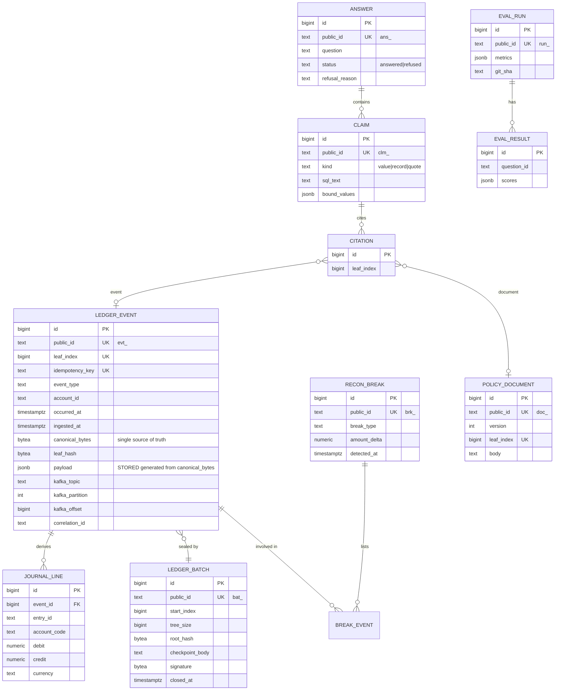

# 05. Backend Structure

> Status: Draft for MC-01. Package, role, and topic names use the final project name `tallyproof` (ADR-0006).

## 1. Repository layout (monorepo)

```
tallyproof/
  backend/
    manage.py
    pyproject.toml               ruff, mypy, pytest, coverage config
    requirements.in              direct runtime deps
    requirements-dev.in          direct dev deps (-c requirements.txt)
    requirements.txt             pinned, compiled by pip-tools
    requirements-dev.txt         pinned, compiled by pip-tools
    config/                      Django project
      settings/                  base.py, local.py, test.py, ci.py (REQ-SEC-06)
      env.py                     pydantic-settings typed settings (REQ-SEC-02)
      urls.py, asgi.py, wsgi.py
    tallyproof_core/             framework-free library, no Django imports
      canonical.py               RFC 8785 serialization
      hashing.py                 leaf/node hashing with domain separation
      merkle/                    log, inclusion proof, consistency proof, verify
      bloom.py                   Bloom filter (+ sizing math)
      checkpoint.py              C2SP checkpoint format, Ed25519 sign/verify
      ids.py                     prefixed public IDs (ULID based)
      money.py                   Decimal money with currency exponent
    apps/
      events/          schemas (Pydantic), JSON Schema export, topic registry
      generator/       scenarios, anomaly injectors, manifest writer, CLI
      ingestion/       consumer loop, validation, dedupe, DLQ, offsets
      ledger/          models, append service, batches, checkpoints, proofs, outbox, journal
      reconciliation/  matching rules, breaks
      analyst/         router, sql_guard, retrieval, composer, verifier, llm/
      evals/           golden set builder, oracle, runner, metrics, thresholds
      lake/            parquet sink, control totals (MLP)
      realtime/        Channels consumers
      health/          /healthz, /readyz
    tests/             unit/, module/, integration/, e2e/ (mirrors apps)
  frontend/            Next.js app (see frontend-guidelines.md)
  infra/
    compose.yaml
    postgres/init/     roles.sql (app role, analyst read-only role), extensions
    redpanda/          topic bootstrap script
  scripts/             replay export, tamper tool, load test
  docs/
  .circleci/config.yml
  Makefile
```

Why `tallyproof_core` is separate from Django apps: the cryptographic and data-structure code is the most reviewed code in the repo. Keeping it pure Python makes it trivially unit-testable, property-testable, and mirrorable in TypeScript, and it lets a reviewer read it without knowing Django.

Event schemas are registered in Redpanda's Schema Registry with BACKWARD compatibility from Phase 2 (moved up from Nice-to-have: it is cheap and expected by data-platform reviewers).

Every app has a `README.md` (REQ-DOC-02) with: responsibilities, public interfaces, events consumed, events produced.

## 2. Public IDs (REQ-URL-02)

Format `<prefix>_<26-char ULID>` (sortable, URL-safe). Database primary keys are internal `bigint` and never appear in URLs (REQ-URL-01).

| Prefix | Entity |
|---|---|
| `evt_` | Ledger event |
| `bat_` | Merkle batch (closed by a checkpoint) |
| `acct_` | Synthetic account (customer or vendor) |
| `inv_` | Invoice reference (business key inside payload) |
| `brk_` | Reconciliation break |
| `doc_` | Policy document version |
| `qry_` | Submitted query |
| `ans_` | Answer |
| `clm_` | Claim within an answer |
| `run_` | Eval run |
| `scn_` | Generator scenario |

## 3. Kafka topics (Redpanda)

Naming: `<domain>.<entity>.<stage>.v<major>`.

| Topic | Key | Partitions (local) | Retention | Producer | Consumers |
|---|---|---|---|---|---|
| `fin.events.raw.v1` | `account_id` | 6 | 7 days | generator | ingestion |
| `fin.events.dlq.v1` | `account_id` | 1 | 30 days | ingestion | replay tool, ops |
| `ledger.appended.v1` | `account_id` | 6 | 7 days | outbox relay | reconciliation, journal, lake, realtime |
| `ledger.checkpoints.v1` | log origin | 1, compacted plus retention | forever (compact) | checkpointer | realtime, witness exporter |
| `recon.breaks.v1` | `account_id` | 3 | 7 days | reconciliation | realtime |

Why key by `account_id`: reconciliation matches payments to invoices for the same account, so per-account ordering matters; the idempotency key of duplicates shares the account, so duplicates land on the same partition and the per-partition Bloom filter sees both. Hot-account skew is a known risk, measured by the Count-Min Sketch in Nice-to-have.

## 4. Event envelope (Pydantic, exported to JSON Schema)

```text
EventEnvelope
  event_id          str   evt_...            unique per emission; a re-delivered duplicate gets a new event_id
  (the logical identity of an event is idempotency_key, which duplicates share)
  idempotency_key   str                      producer-level key; duplicates share it
  event_type        enum  invoice.issued | payment.received | refund.issued | adjustment.posted | credit_note.issued
  schema_version    int   1
  occurred_at       datetime (UTC, RFC 3339)  event time
  emitted_at        datetime (UTC)            producer time (late arrivals: emitted_at >> occurred_at)
  account_id        str   acct_...
  scenario_id       str   scn_...
  correlation_id    str                       traces one event end to end (Section 14)
  payload           discriminated union by event_type
```

Payload examples:
- `invoice.issued`: `invoice_ref`, `amount` (decimal string), `currency` (ISO 4217), `due_date`, `line_items[]`, `memo`.
- `payment.received`: `payment_ref`, `amount`, `currency`, `fx_rate_to_base` (decimal string, optional), `applies_to_invoice_ref` (optional), `method`, `memo`.
- `refund.issued`: `refund_ref`, `original_payment_ref`, `amount`, `currency`, `reason`.
- `adjustment.posted`: `adjustment_ref`, `target_ref`, `amount`, `reason`.

### Leaf document contract (what is hashed)

The hashed `LeafDocument` contains exactly: `event_id`, `idempotency_key`, `event_type`, `schema_version`, `occurred_at`, `emitted_at`, `account_id`, `payload`. Transport and tracing fields (`scenario_id`, `correlation_id`, Kafka coordinates) are excluded so they can never affect a proof. Validation rules that make cross-language hashing safe (events failing them go to the DLQ):

- No JSON numbers except integers in `[0, 2^53)`. Money, rates, and quantities are decimal strings.
- All strings must be valid Unicode scalar values (no lone surrogates). The generator's `injection_memo` cases include zero-width and right-to-left characters on purpose, and they are part of the cross-language test vectors.
- IDs are ULIDs minted from an injectable clock and seeded RNG (`new_id(prefix, clock, rng)`), so a seed reproduces the same IDs.

**Ground-truth labels are never in the event.** They are written by the generator to `manifest.jsonl` keyed by `event_id`, read only by the eval harness. If labels were in events, the analyst could read the answer key and evals would be meaningless.

`memo` and `reason` are free text and are where prompt-injection payloads are planted by the generator (anomaly type `injection_memo`).

## 5. Anomaly catalog (v1)

Each type has a stable label used in the manifest and evals. All are deterministic given the seed.

| Label | Injection | Detected by | Expected break / behavior |
|---|---|---|---|
| `duplicate_delivery` | Same idempotency key re-sent (same or different partition timing) | Ingestion dedupe | Rejected, logged in `dedupe_rejection` |
| `duplicate_invoice_semantic` | Same vendor, amount, date, different ref | Reconciliation | `brk_` type `possible_duplicate_invoice` |
| `amount_mismatch` | Payment differs from invoice beyond tolerance | Reconciliation | `amount_mismatch` |
| `partial_payment` | Payment < invoice, remainder open | Reconciliation | `partial_open` (not an error, tracked) |
| `split_payment` | Several payments sum to invoice | Reconciliation | Matched set, no break |
| `overpayment` | Payment > invoice | Reconciliation | `overpayment` |
| `orphan_payment` | Payment referencing no invoice | Reconciliation | `orphan_payment` |
| `late_arrival` | `emitted_at` far after `occurred_at`, possibly after period close | Reconciliation (watermark) | `late_after_close`. Periods are calendar months; a period closes when the watermark (max `occurred_at` seen minus `RECON_LATE_ARRIVAL_WATERMARK_HOURS`) passes month end. Late events post to the open period with a reference to the closed one, never by editing it |
| `fx_rounding` | Converted amount off by rounding beyond policy | Reconciliation | `fx_rounding_variance` |
| `refund_exceeds_payment` | Refund total > original payment | Reconciliation | `refund_exceeds_original` |
| `vendor_burst` | Many small invoices from one vendor in a window | Heavy hitters (Nice-to-have) and analyst | Flag only |
| `injection_memo` | Memo contains instructions aimed at the LLM | Analyst defenses | Answer unaffected; eval measures it |
| `schema_invalid` | Malformed event | Ingestion validation | DLQ |

Scenario sizes: `smoke` (about 500 events), `demo` (about 5,000), `full` (about 50,000), `volume` (1M+ for lake and load tests).

## 6. Database schema (initial, Django models)

ER draft:



Supporting tables: `merkle_log_head` (single row, next leaf index), `consumer_offset`, `dedupe_rejection`, `outbox`, `doc_chunk` (with `embedding vector(384)`). A subtree cache is deferred until the load test shows proof latency needs it.

`payload` is a STORED generated column computed from `canonical_bytes` (ADR-0015), so analyst views cannot read anything the proof does not cover.

Constraints worth calling out:
- `NUMERIC(19,4)` for money; `CHECK (debit >= 0 AND credit >= 0 AND (debit = 0) <> (credit = 0))`.
- Deferred constraint trigger: sum of debits equals sum of credits per `entry_id`.
- `UNIQUE (idempotency_key)`, `UNIQUE (leaf_index)`.
- Append-only triggers on `ledger_event`, `ledger_batch`, `journal_line`, `policy_document`; TRUNCATE revoked from the app role (the owner role can still truncate, which tamper ladder level 1 already covers).
- Every schema change ships as its own migration PR (brief Section 14).

### Database roles (`infra/postgres/init/roles.sql`)
- `tallyproof_app`: INSERT/SELECT on ledger tables, no UPDATE/DELETE on append-only tables.
- `tallyproof_analyst`: SELECT only on schema `analyst` (curated views), `default_transaction_read_only = on`, `statement_timeout` and `work_mem` set at role level (REQ-SEC-07).
- `tallyproof_owner`: owns the schema and runs migrations through a separate `DB_OWNER_URL` and a dedicated `migrations` database alias.
- Roles are created by `make db-roles` (a psql script run identically in compose and CI), not by container init scripts, because init scripts cannot run in CI service containers. Grants live in an idempotent RunSQL migration with `ALTER DEFAULT PRIVILEGES`, so they apply to tables created later. Tests connect as owner and use `SET ROLE` to assert grants.

### Analyst views (schema `analyst`)
`analyst.events`, `analyst.invoices`, `analyst.payments`, `analyst.refunds`, `analyst.open_items`, `analyst.breaks`, `analyst.journal`. Every view exposes `event_id` so provenance can be derived. Views hide `canonical_bytes`, offsets, and internal IDs.

## 7. API (REQ-URL-01..05)

Versioned under `/api/v1/`. JSON. OpenAPI via drf-spectacular at `/api/v1/schema/` with docs at `/api/v1/docs/`.

| Method | Path | Purpose |
|---|---|---|
| GET | `/api/v1/events` | Paginated list (cursor), filters `account_id`, `event_type`, `occurred_after` |
| GET | `/api/v1/events/{event_id}` | Event with canonical bytes (base64) and leaf index |
| GET | `/api/v1/events/{event_id}/proof` | Inclusion proof against latest or `?checkpoint={batch_id}` |
| GET | `/api/v1/batches` | Batches with checkpoints |
| GET | `/api/v1/batches/{batch_id}` | One batch, its checkpoint and signature |
| GET | `/api/v1/batches/{batch_id}/consistency?from={batch_id}` | Consistency proof between checkpoints |
| GET | `/api/v1/checkpoints/latest` | Latest signed checkpoint |
| GET | `/api/v1/log-key` | Public key and log origin |
| POST | `/api/v1/queries` | Ask a question; returns `ans_` (rate limited, REQ-SEC-10) |
| GET | `/api/v1/answers/{answer_id}` | Answer with claims, bound values, citations |
| GET | `/api/v1/reconciliation/breaks` | Breaks, filter by type and account |
| GET | `/api/v1/reconciliation/breaks/{break_id}` | One break with involved events |
| GET | `/api/v1/policy-documents/{document_id}` | Document version with leaf index |
| GET | `/api/v1/eval-runs` | Runs list |
| GET | `/api/v1/eval-runs/{run_id}` | Metrics and per-question results |
| GET | `/healthz` | Liveness, no dependencies |
| GET | `/readyz` | Checks broker, database, cache (REQ-URL-05) |

WebSocket: `/ws/v1/stream` (ledger appended, checkpoints, breaks).

Proof response shape:

```json
{
  "event_id": "evt_01J...",
  "leaf_index": 4211,
  "canonical_event_b64": "...",
  "leaf_hash_hex": "...",
  "audit_path_hex": ["...", "..."],
  "checkpoint": {
    "batch_id": "bat_01J...",
    "origin": "tallyproof.dev/log/v1",
    "tree_size": 5000,
    "root_hash_b64": "...",
    "body": "...",
    "signature_b64": "...",
    "key_id": "..."
  }
}
```

The API never returns `"verified": true`. Verification is the client's job (REQ-URL-04).

Errors follow RFC 9457 (`application/problem+json`).

## 8. Workers (management commands)

`run_ingestion`, `run_checkpointer`, `run_outbox_relay`, `run_reconciliation`, `run_lake_sink`, `generate_scenario`, `export_replay_bundle`, `export_witness`, `tamper` (local demo only, refuses to run unless `DEMO_TAMPER_ENABLED=true`).
